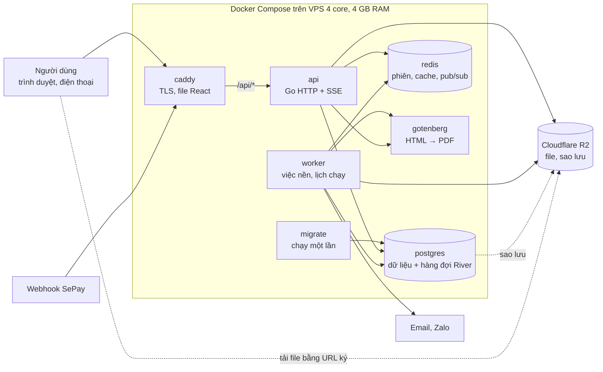

# Thiết kế hệ thống MEnglish mới: React + Go + PostgreSQL

Phiên bản 12/10/2026 · Người yêu cầu: Desiglobal

## Tóm tắt

Dựng mới một hệ thống quản lý trung tâm Anh ngữ tương đương MEnglish bằng **React (SPA) + Go (API) + PostgreSQL**, đóng gói **Docker**, dùng **Redis** cho phiên đăng nhập, cache, giới hạn tốc độ và thông báo tức thời. Hệ thống Laravel hiện tại chỉ là bản mô tả nghiệp vụ: chức năng, vai trò, công thức lương/KPI/học phí được lấy từ code đang chạy; không giữ database cũ, không chạy song song.

Phạm vi tham chiếu (đếm trên `main` ngày 12/10/2026): 92 model, \~100 bảng nghiệp vụ, 58 controller (\~34.300 dòng), \~560 route, 21 việc chạy định kỳ, 293 màn/component Vue, 9 vai trò, 224 quyền, 1.437 test.

Sáu quyết định chính:

1. **Một chương trình Go chia module theo phân hệ** (modular monolith). Một Docker image chạy hai vai trò: `api` (HTTP) và `worker` (việc nền, lịch chạy).
2. **PostgreSQL 18, mỗi phân hệ một schema** (`iam`, `crm`, `academic`, `finance`, `hr`...). Tiền lưu `BIGINT` theo đồng, thời gian `timestamptz`, chống trùng lịch phòng/giáo viên bằng ràng buộc của DB.
3. **Việc nền chạy trên Postgres (River)**, xếp hàng trong cùng transaction nghiệp vụ. Redis không giữ dữ liệu quan trọng, mất Redis chỉ làm mọi người phải đăng nhập lại.
4. **Phân quyền giữ mô hình đang dùng tốt**: quyền `module.action`, phạm vi dữ liệu của tôi/chi nhánh/tất cả, ghi đè theo người, 9 vai trò mặc định; thêm kiểm quyền theo bản ghi tường minh.
5. **React 19 + TanStack Router/Query + shadcn/ui + Tailwind 4**, design system giữ thương hiệu cam và sửa các lỗi tương phản, cỡ chữ, điện thoại đã đo được ở hệ thống cũ.
6. **Docker Compose trên một VPS**: Caddy, api, worker, PostgreSQL, Redis, Gotenberg (PDF) trên VPS 4 core, 4 GB RAM, 30 GB SSD; file người dùng và bản sao lưu nằm trên Cloudflare R2. Không phụ thuộc hosting PHP.

Tài liệu này là thiết kế, không sửa repo hiện tại. Thời gian ước cho đội 3 lập trình viên.

## Phạm vi chức năng

Hệ thống mới phải làm được những gì MEnglish hiện tại đang làm. Phần này tóm tắt từ code đang chạy (Laravel 13 + Inertia + Vue 3) và các tài liệu trong dự án; tên bảng ở cột giữa là bảng của hệ thống cũ, dùng để tra cứu nghiệp vụ.

### Phân hệ nghiệp vụ

| Phân hệ | Bảng chính | Route | Controller lớn nhất (dòng) |
| --- | --- | --- | --- |
| Người dùng, chi nhánh, phân quyền | users, branches, user\_branches, roles, permissions, user\_permission\_overrides | \~40 | UserController, SystemConfigController 1.072 |
| CRM & tuyển sinh | crm\_customers (9 giai đoạn), crm\_customer\_histories, crm\_trial\_bookings, crm\_branch\_transfers, promotions | 42 | CrmController 3.247 |
| Test đầu vào | placement\_tests, placement\_test\_submissions | 22 | PlacementTestController 1.098 |
| Học viên & lớp | students, classes, class\_enrollments, courses, course\_levels, rooms, holidays | \~50 | ClassManagementController 1.150 |
| Buổi học, điểm danh, chăm sóc | class\_sessions, student\_attendances, homeworks, class\_reports, staff\_reports | \~45 | TeacherPortalController 1.586 |
| Giáo trình & học thuật | syllabus\_\* (4 cấp), big\_tests, academic\_projects, academic\_records | \~76 | SyllabusController 2.282 |
| Học phí & thu chi | student\_tuitions, tuition\_receipts, invoice\_configurations, refund, sepay\_\* | \~42 | TuitionController 3.403 |
| Lương, KPI, phạt, hoa hồng | payroll\_periods, payroll\_records (\~30 cột tiền), teacher\_rates, kpi\_*, penalties, commission\_*, sla\_\* | \~55 | PayrollController 2.136, KpiController 874 |
| Chấm công nhân sự | staff\_attendances (GPS + ảnh), staff\_attendance\_requests | \~15 | StaffAttendanceController |
| Công việc, ticket, phê duyệt | work\_tasks, support\_tickets, ticket\_messages, admin\_notifications | \~45 | WorkTaskController 2.342 |
| Cổng phụ huynh & học sinh | academic\_records (JSON), students | 24 | StudentPortalController 1.087 |
| Học liệu, hàng hóa | material\_orders, merchandise\_\* | \~22 |  |

### Vai trò và phân quyền

- **9 vai trò cố định** (`app/Support/Roles.php`): Admin, Quản lý cơ sở, Trưởng học thuật, Học vụ, Tư vấn tuyển sinh, GV Full-time, GV Part-time, Trợ giảng, Học sinh. Admin tạo thêm vai trò tùy chỉnh được.
- **224 quyền tĩnh** khai báo trong `config/permission_catalog.php`: 168 quyền thao tác dạng `module.action`, 48 quyền phạm vi dữ liệu `module.scope_own|branch|all`, 8 quyền "đối tượng" (`class.teach`, `portal.student`...), cộng quyền động `user.assign_role.<vai trò>`.
- **Thứ tự quyết định** (`AppServiceProvider` `Gate::before`): Admin được tất cả (trừ quyền đối tượng) → 9 quyền duyệt chỉ Admin → ghi đè theo người (cho hoặc thu hồi) → quyền của vai trò (spatie). Không có Policy; kiểm tra theo bản ghi nằm trong controller.
- **Phạm vi dữ liệu** (`DataScope`): mức cao nhất trong `scope_own < scope_branch < scope_all`; chi nhánh của người dùng = `users.branch_id` + bảng `user_branches`. Dùng ở 31 file và 12 scope `visibleTo`.
- **Menu theo quyền, không theo tên vai trò**: `SidebarMenu.php` đọc quyền `can:` của từng route (326 chỗ).

### Đăng nhập và bề mặt công khai

- Đăng nhập bằng email hoặc mã tài khoản (`MES001`, `HV-...`), phiên cookie lưu DB 120 phút, nhớ đăng nhập, bắt đổi mật khẩu lần đầu, khóa tài khoản kiểm mỗi request, giới hạn 5 lần sai/email+IP.
- Không có API token (không Sanctum/Passport). Các "API" hiện tại đều là route web dùng phiên.
- Công khai: link làm bài test đầu vào (URL ký, hạn 7 ngày, token mã hóa bằng APP\_KEY), webhook SePay (HMAC hoặc API key), cổng tuyển dụng, deploy hook.

### Logic nghiệp vụ phải làm lại chính xác

- **Lương**: kỳ theo tháng; Part-time = ca hợp lệ × đơn giá hiệu lực tại ngày dạy, trừ đi muộn theo phút; Full-time = lương cơ bản + KPI + thưởng tái tục − BHXH 10,5% − công đoàn 0,5%; hoa hồng tuyển sinh theo thứ tự chốt và "gate kép" 30 ngày + 3 mốc chăm sóc; phạt chỉ trừ biên bản đã quyết. Duyệt kỳ bị chặn nếu dữ liệu đổi sau lần tính gần nhất; duyệt xong khóa ghi chấm công và phạt vào kỳ đó.
- **KPI**: phiếu tháng/quý, 15 tiêu chí Học vụ, xếp loại A–E, mục tự đếm và mục chấm tay.
- **SLA**: 21 lịch chạy (15 phút, hàng giờ, hằng ngày) tự giao việc và tự sinh biên bản vi phạm, idempotent nhờ unique `(rule_key, subject_type, subject_id)`.
- **Sổ buổi học** (`SessionLedger`, 456 dòng): tính tại chỗ số buổi đã đóng − đã học, trừ khoảng bảo lưu.
- **Đánh số chứng từ**: `document_sequences` khóa dòng (HV-00001, BT-YYYY-0001, BB-YYYY-001...), dải số hóa đơn điện tử/giấy theo chi nhánh.
- **Hộp phê duyệt**: 13 nguồn duyệt (phiếu thu, hoàn phí, đề xuất giáo trình, đơn chấm công...) gom về một hộp; mỗi nguồn gọi lại route POST gốc của phân hệ.

### Những điểm làm khác hệ thống cũ

Dựng mới nên sửa luôn các điểm yếu đã ghi trong hai lần audit codebase và rà soát UI/UX:

| Hệ thống cũ | Hệ thống mới |
| --- | --- |
| Tiền tính bằng `float` rồi `round()` từng bước | Số nguyên đồng (`int64`), quy tắc làm tròn ghi rõ cho từng công thức |
| Email gửi đồng bộ, có chỗ gửi ngay trong transaction duyệt phiếu thu | Xếp hàng việc nền trong transaction, gửi sau khi commit, tự thử lại |
| `academic_records`: một bảng JSON chung cho báo đóng tiền, nộp bài, khảo sát, góp ý | Bảng riêng có cột và khóa ngoại rõ ràng |
| Unique bị bản ghi đã xóa mềm chiếm chỗ, phải có bộ sinh mã né trùng | Unique có điều kiện `WHERE deleted_at IS NULL` |
| Trùng lịch phòng/giáo viên kiểm bằng so chuỗi `HH:MM` trong code | Ràng buộc exclusion trên khoảng thời gian, DB từ chối bản ghi trùng |
| Khóa SePay, mật khẩu SMTP lưu dạng rõ | Mã hóa AES-GCM, khóa nằm ngoài DB |
| Kiểm quyền theo bản ghi rải trong controller, từng để lọt (sửa tài khoản, lập phạt chi nhánh khác) | Hàm policy tường minh cho từng loại bản ghi, có test bắt buộc |
| Tính lương N+1 (\~10–15 query mỗi người) | Nạp dữ liệu gộp một lần, tính bằng hàm thuần |
| File tải lên rải ở 3 thư mục, có file công khai không kiểm quyền | Một kho đối tượng riêng tư (Cloudflare R2), tải bằng URL ký ngắn hạn |
| Mã ULID 26 ký tự hiện trên màn hình, tài khoản học viên khó gõ | Mã ngắn theo quy tắc (HV-00001, PT-2026-000123), học viên đăng nhập bằng mã hoặc SĐT phụ huynh |
| Không có API cho bên ngoài | API REST có tài liệu OpenAPI, dùng được cho app di động sau này |
| Không giám sát lỗi tập trung, `activity_log` không bao giờ dọn | Sentry, Prometheus, log JSON; nhật ký chia phân vùng theo tháng, dọn theo chính sách |

## Kiến trúc tổng thể

Người dùng và webhook SePay đi qua một cổng Caddy duy nhất; Caddy phục vụ file React và chuyển `/api/*` sang tiến trình `api`. Tiến trình `worker` cùng image, chạy việc nền và gửi tin ra ngoài. Postgres, Redis, Gotenberg chỉ nằm trong mạng nội bộ của Docker; file tải lên và bản sao lưu nằm trên Cloudflare R2, ngoài VPS.



Mất Redis chỉ làm người dùng đăng nhập lại và mất thông báo tức thời; việc nền và dữ liệu tiền bạc đều nằm trong PostgreSQL.

## Backend Go

Backend là **một chương trình Go chia module theo phân hệ (modular monolith)**, không tách microservice. Lý do: đội nhỏ, một DB, và nhiều nghiệp vụ cần một transaction xuyên phân hệ (duyệt phiếu thu → cấp số hóa đơn → cập nhật công nợ → ghi sổ hoa hồng). Ranh giới module giữ bằng quy tắc import và schema Postgres riêng, nên tách ra sau này được nếu cần.

### Thư viện

| Việc | Chọn | Ghi chú |
| --- | --- | --- |
| HTTP | `net/http` + chi | Middleware chuẩn, tương thích thư viện chuẩn |
| Hợp đồng API | OpenAPI 3.1 viết trước, `oapi-codegen` sinh stub server | Cùng file sinh client TypeScript cho React |
| Truy cập DB | `pgx/v5` + `sqlc` (SQL viết tay → code Go có kiểu); `squirrel` cho danh sách nhiều bộ lọc | Không dùng ORM; thấy rõ từng query |
| Migration | `goose`, file SQL | Chạy tự động khi deploy, trước khi api khởi động |
| Việc nền, lịch chạy | River (hàng đợi trên Postgres) + `PeriodicJob` | Xếp hàng trong cùng transaction; không mất việc khi Redis lỗi |
| Redis | `go-redis/v9` | Phiên, giới hạn tốc độ, cache quyền/menu, pub/sub thông báo |
| Tiền | `int64` đồng; tỷ lệ dùng `shopspring/decimal` | Không dùng float; hàm `money.Round` dùng chung |
| Kiểm tra đầu vào | `go-playground/validator` + thông báo tiếng Việt |  |
| Mật khẩu | argon2id (`x/crypto/argon2`) |  |
| Excel | `excelize` | Nhập lead, học phí; xuất báo cáo; chống chèn công thức |
| PDF | Gotenberg (Chromium) render từ HTML; đọc PDF đề test bằng `pdfcpu` | Phiếu lương, bill học phí, biên bản vi phạm |
| File | `minio-go` (S3 API) | Cloudflare R2 (dev dùng MinIO), kho riêng tư, URL ký 5 phút |
| Log, đo đạc | `log/slog` (JSON), Prometheus `/metrics`, OpenTelemetry, Sentry |  |

### Cấu trúc mã

```text
api/
  cmd/menglish/        main: `menglish api` | `menglish worker` | `menglish migrate`
  openapi/             menglish.yaml (nguồn sự thật của API)
  db/migrations/       goose SQL;  db/queries/<module>/*.sql cho sqlc
  internal/
    platform/          config, db (tx helper), httpx (lỗi, phân trang), clock, money, codes, filestore, redis
    iam/               người dùng, chi nhánh, đăng nhập, phiên, vai trò, quyền, phạm vi dữ liệu
    audit/             nhật ký thay đổi (trước/sau), che trường nhạy cảm
    notify/            thông báo trong app, email, Zalo ZNS, đẩy realtime (SSE)
    approval/          hộp phê duyệt: interface Source, đăng ký các nguồn
    shell/             menu sidebar, workspace, chip đếm theo quyền
    crm/ placement/ student/ class/ schedule/ attendance/ syllabus/ bigtest/ project/
    tuition/ invoice/ payment/ (SePay) payroll/ kpi/ penalty/ sla/ commission/
    staffattendance/ task/ ticket/ portal/ inventory/ report/ settings/
```

Mỗi module có 3 lớp: `handler` (HTTP, DTO, kiểm tra đầu vào) → `service` (nghiệp vụ, mở transaction, kiểm quyền theo bản ghi) → `store` (query sqlc trên schema của module). Module chỉ gọi nhau qua interface của `service`, không truy vấn schema của module khác (kiểm bằng `depguard`; ngoại lệ duy nhất là view báo cáo chỉ đọc).

### Quy ước API

- REST JSON dưới `/api/v1`, danh từ số nhiều: `GET /api/v1/crm/leads`, `GET /api/v1/crm/leads/{id}`.
- Thao tác nghiệp vụ là động từ con: `POST /crm/leads/{id}/stage-transitions`, `POST /finance/receipts/{id}/approve`, `POST /payroll/periods/{id}/recalculate`.
- Danh sách: `?page=&per_page=&sort=&q=` + bộ lọc; trả `{data: [...], meta: {page, per_page, total, counts}}` (`counts` cho chip lọc nhanh). Danh sách rất lớn (nhật ký, giao dịch) dùng phân trang theo con trỏ.
- Lỗi theo RFC 9457 (`application/problem+json`); lỗi nhập liệu trả 422 kèm `errors: {field: ["thông báo tiếng Việt"]}`.
- Thao tác tiền bạc (lập/duyệt phiếu thu, hoàn phí, duyệt lương) bắt buộc header `Idempotency-Key`, kết quả lưu 24 giờ.
- Sửa bản ghi dùng `If-Match` (ETag từ cột `version`) để hai người sửa cùng lúc không ghi đè nhau.
- Trường nhạy cảm (lương, CCCD, khóa tích hợp) chỉ có trong phản hồi khi người gọi có quyền; DTO tách riêng, không trả nguyên bản ghi.
- Thông báo tức thời (chuông, số cần duyệt, Kanban có người khác kéo) qua `GET /api/v1/events` (Server-Sent Events), nguồn là Redis pub/sub.

### Đăng nhập và phân quyền

- Đăng nhập bằng email, mã nhân viên (`MES001`), mã học viên (`HV-00001`) hoặc SĐT phụ huynh. Giới hạn 5 lần sai mỗi tài khoản + IP và 30 lần/IP/10 phút (đếm bằng Redis). Bắt đổi mật khẩu lần đầu; quên mật khẩu luôn trả cùng một thông báo.
- **Phiên**: cookie `HttpOnly; Secure; SameSite=Lax` chứa token ngẫu nhiên 256 bit; Redis giữ `session:<hash>` → user, hết hạn trượt 8 giờ (30 ngày nếu "Ghi nhớ"). Chống CSRF bằng header `X-CSRF-Token`. Đổi mật khẩu hoặc khóa tài khoản xóa mọi phiên của người đó ngay. App di động sau này dùng cùng cơ chế qua header `Authorization: Bearer`.
- **Quyền**: danh mục quyền khai báo trong code (`iam/catalog.go`), giữ cách đặt tên và nhóm của `config/permission_catalog.php`: quyền thao tác `module.action`, quyền phạm vi `module.scope_own|branch|all`, quyền đối tượng (`class.teach`, `portal.student`...). Khi khởi động, danh mục được đồng bộ xuống bảng `iam.permissions`.
- **Thứ tự quyết định**: Admin được tất cả (trừ quyền đối tượng) → quyền chỉ-Admin → ghi đè theo người (cho hoặc thu hồi) → quyền của vai trò. Tập quyền đã tính của mỗi người cache trong Redis, xóa khi vai trò/ghi đè thay đổi.
- **Phạm vi dữ liệu**: `iam.Scope(ctx, "crm")` trả own/branch/all + danh sách chi nhánh; mỗi store có `applyScope` thêm điều kiện SQL. Test bắt buộc cho mỗi danh sách: người chi nhánh A không thấy dữ liệu chi nhánh B.
- **Kiểm quyền theo bản ghi** bằng hàm policy tường minh trong `service` (`CanEditUser(actor, target)`, `CanFinePenalty(actor, penalty)`...), không để trong handler.

### Việc nền và sự kiện

- **Lịch chạy**: 21 việc định kỳ của hệ thống cũ (SLA 15 phút, đánh dấu việc quá hạn, nhắc nợ T-7/T-3/T0/T+3, tạo phiếu KPI, bắt đầu/kết thúc bảo lưu, kiểm tiền mặt chưa nộp 19:00...) là `PeriodicJob` của River, chạy theo giờ Việt Nam, chỉ một worker nhận mỗi lượt. Mọi việc đều idempotent (chạy lại không tạo trùng).
- **Gửi ra ngoài** (email, Zalo ZNS, thông báo): `service` xếp việc River trong cùng transaction; worker gửi sau khi commit, thử lại theo lũy thừa, màn quản trị xem việc lỗi.
- **Sự kiện trong tiến trình**: `ReceiptApproved`, `ReceiptCancelled`, `LeadStageChanged`, `SessionHeld`, `PenaltyFined`... để module khác phản ứng (hoa hồng, thu hồi hoa hồng, SLA, KPI tự đếm) mà không import chéo.
- **Webhook SePay**: xác thực HMAC-SHA256 hoặc API key, chống trùng bằng unique `provider_txn_id`, khớp nội dung chuyển khoản theo mã thanh toán → mã học viên → mã lead, khóa dòng công nợ khi ghi phiếu thu.
- **Nhật ký**: `audit` ghi trước/sau (JSONB) cho các bảng quan trọng, kèm người thao tác, IP, request id; cho hoàn tác một số trường như hệ thống cũ.

### Các động cơ tính toán

Lương, KPI, sổ buổi học, báo giá học phí và hoa hồng viết thành **hàm thuần** (không đụng DB): nạp đủ đầu vào bằng vài query gộp, tính trong bộ nhớ, ghi kết quả trong một transaction.

```text
payroll.Calculate(PeriodInput{Staff, Timesheets, Rates, KpiSheets, Receipts,
                  Penalties, Commissions, Params, ManualLines}) -> []PayslipResult
ledger.Balance(Enrollments, Sessions, Deferrals, PaidSessions)  -> SessionBalance
kpi.Score(Criteria, Items, AutoCounts)                           -> SheetScore (A–E)
```

- Mỗi phiếu lương lưu `calculation_details` (JSONB) giải thích từng dòng tiền, để kế toán đối soát và nhân sự xem "vì sao ra số này".
- Tính lại và duyệt kỳ cùng khóa dòng kỳ lương (`SELECT ... FOR UPDATE`) rồi kiểm lại trạng thái trong transaction. Kỳ đã duyệt chặn ghi chấm công, phạt, KPI vào ngày thuộc kỳ đó (kiểm ở service và bằng trigger DB).
- Công thức và tham số (đơn giá phút đi muộn, ngưỡng 15 phút, BHXH 10,5%, công đoàn 0,5%, bậc hoa hồng, % tái tục...) lưu có phiên bản hiệu lực theo ngày, kỳ cũ tính lại vẫn ra số cũ.
- Bộ test bảng dữ liệu lấy kịch bản từ test hiện có của hệ thống cũ (Phase3Formula, Phase3Commission, PayrollBusiness, SessionLedger, Kpi\*...) làm chuẩn đầu ra.

## Dữ liệu (PostgreSQL + Redis)

Một database PostgreSQL 18 tên `menglish`, **mỗi phân hệ một schema**. Postgres là nơi duy nhất giữ dữ liệu nghiệp vụ và hàng đợi việc nền; Redis chỉ giữ thứ mất đi không sai số liệu.

### Quy ước chung

- **Khóa chính** `id uuid DEFAULT uuidv7()` (hàm có sẵn từ Postgres 18): sắp theo thời gian, không đoán được, dùng thẳng trên API và app di động. Người dùng nhìn thấy **mã nghiệp vụ ngắn** (`code`: HV-00001, PT-2026-000123, BB-2026-001) sinh từ bảng `core.document_sequences` bằng một câu `UPDATE ... RETURNING`.
- **Tiền** `bigint` theo đồng, có `CHECK` âm/dương phù hợp; tỷ lệ `numeric(7,4)`; điểm `numeric(4,1)`.
- **Thời gian**: mốc thời gian `timestamptz`; ngày nghiệp vụ (ngày học, ngày công, hạn đóng tiền) `date`; giờ ca `time`; kỳ tháng là `date` ngày mùng 1. Mọi phép "hôm nay", "cuối tháng" tính theo `Asia/Ho_Chi_Minh` qua một `clock` dùng chung.
- **Trạng thái** `text` + `CHECK (status IN (...))`, không dùng kiểu enum (thêm giá trị không phải khóa bảng).
- **Xóa mềm** chỉ cho hồ sơ và danh mục (lead, học viên, lớp, nhân sự, khóa học); unique đi kèm `WHERE deleted_at IS NULL`. Chứng từ tiền (phiếu thu, phiếu lương, hoa hồng) không bao giờ xóa: chỉ hủy và ghi bút toán đảo.
- Mọi bảng có `created_at`, `updated_at`, `created_by`, `version` (khóa lạc quan cho `If-Match`). Bảng nghiệp vụ có `branch_id` để lọc phạm vi, index bắt đầu bằng `branch_id`.
- **JSONB** chỉ cho dữ liệu linh hoạt thật: câu hỏi và đáp án đề test, rubric, `calculation_details`, payload webhook gốc.
- Không dùng Row-Level Security ở bản đầu; phân quyền nằm ở `iam` trong app.

### Schema theo phân hệ

| Schema | Bảng chính | Ghi chú |
| --- | --- | --- |
| `core` | branches (tọa độ, bán kính chấm công, giờ làm), rooms, room\_types, holidays, holiday\_branches, settings, document\_sequences, files, notifications, audit\_log | `audit_log` chia phân vùng theo tháng |
| `iam` | users, user\_branches, roles, permissions, role\_permissions, user\_roles, permission\_overrides, staff\_profiles, guardians | Lương cơ bản, CCCD nằm riêng trong `staff_profiles` để dễ kiểm quyền |
| `crm` | leads, lead\_events, trial\_bookings, branch\_transfers, promotions, lead\_sources, lost\_reasons | 9 giai đoạn; mọi chuyển giai đoạn ghi `lead_events` |
| `placement` | tests, invitations, submissions | Link mời lưu hash token + hạn; vi phạm làm bài lưu JSONB |
| `academic` | courses, course\_levels, students, classes, class\_slots, class\_sessions, session\_staff, enrollments, deferrals, student\_attendance, remarks, homeworks, homework\_submissions, class\_reports | Không còn bảng JSON chung `academic_records` |
| `syllabus` | curricula, stages, units, lessons, documents, document\_views, assignments, change\_proposals, pacing\_requests, big\_tests, big\_test\_orders, big\_test\_results, projects, milestones, project\_updates |  |
| `finance` | tuitions, tuition\_fee\_items, receipts, receipt\_allocations, invoice\_ranges, invoice\_cancellations, refund\_requests, bank\_accounts, payment\_providers, bank\_transactions, payment\_reports, debt\_reminder\_rules, expenses | Khóa SePay trong `payment_providers` mã hóa AES-GCM |
| `hr` | teaching\_shifts, timesheets, rates (hiệu lực theo ngày), staff\_attendance, attendance\_requests, penalties, sla\_rules, sla\_events, kpi\_criteria, kpi\_sheets, kpi\_items |  |
| `payroll` | periods, payslips, payslip\_lines, params (có phiên bản), commission\_tiers, commission\_items, commission\_adjustments | Phiếu lương = nhiều dòng thay cho \~30 cột tiền cố định của hệ thống cũ |
| `ops` | work\_tasks, tickets, ticket\_messages, surveys, survey\_responses, material\_orders, inventory\_items, stock, stock\_movements, job\_postings, candidates |  |

### Ràng buộc để DB tự giữ đúng

```sql
-- Không hai buổi trùng giờ cùng phòng (buổi đã hủy không tính)
CREATE EXTENSION IF NOT EXISTS btree_gist;
ALTER TABLE academic.class_sessions
  ADD CONSTRAINT no_room_overlap
  EXCLUDE USING gist (room_id WITH =, period WITH &&) WHERE (status <> 'cancelled');

-- Giáo viên, GVNN, trợ giảng không đứng hai lớp cùng lúc
ALTER TABLE academic.session_staff
  ADD CONSTRAINT no_staff_overlap
  EXCLUDE USING gist (user_id WITH =, period WITH &&) WHERE (active);

-- Mã học viên không trùng, bản ghi đã xóa không chiếm chỗ
CREATE UNIQUE INDEX students_code_uq ON academic.students (code) WHERE deleted_at IS NULL;

-- Mỗi tháng một kỳ lương, mỗi người một phiếu trong kỳ
ALTER TABLE payroll.periods  ADD CONSTRAINT periods_month_uq  UNIQUE (month);
ALTER TABLE payroll.payslips ADD CONSTRAINT payslips_staff_uq UNIQUE (period_id, user_id);
```

- `period` là cột `tstzrange` tính từ ngày + giờ bắt đầu/kết thúc buổi.
- Trigger chặn ghi `hr.timesheets`, `hr.penalties`, `hr.staff_attendance`, `hr.kpi_items` vào ngày thuộc kỳ lương đã duyệt (lớp bảo vệ thứ hai sau service).
- Unique cho tính idempotent: `hr.sla_events (rule_key, subject_type, subject_id)`, `finance.bank_transactions (provider, provider_txn_id)`, `hr.timesheets (user_id, session_id)`.

### Redis dùng cho gì

| Khóa | Hết hạn | Mất thì sao |
| --- | --- | --- |
| `session:<hash token>` | 8 giờ trượt (30 ngày nếu ghi nhớ) | Người dùng đăng nhập lại |
| `rl:login:<tài khoản>:<ip>`, `rl:ip:<ip>` | 10–15 phút | Bộ đếm số lần sai về 0 |
| `authz:<user_id>` (tập quyền + phạm vi) | 10 phút, xóa khi đổi vai trò/ghi đè | Tính lại từ Postgres |
| `shell:<user_id>` (menu), `counts:approvals:<user_id>` | 60 giây–5 phút | Tính lại |
| Kênh pub/sub `user:<id>`, `branch:<id>` |  | Mất thông báo tức thời, dữ liệu vẫn đúng khi tải lại |

Mọi khóa đều có hạn; chính sách `volatile-lru` và `maxmemory 256mb` (dư cho một trung tâm, production dùng DB 0, staging DB 1) để phiên không bị đẩy ra. Bật AOF `everysec` để khởi động lại Redis không đăng xuất mọi người.

### Sao lưu và dữ liệu ban đầu

- Postgres: WAL archive liên tục + bản sao lưu đầy đủ hằng đêm bằng pgBackRest lên bucket sao lưu trên Cloudflare R2, giữ 30 ngày, khôi phục về thời điểm bất kỳ. Thử khôi phục mỗi tháng.
- File: nằm sẵn trên R2, ứng dụng chỉ xóa mềm và dọn sau 30 ngày; chi tiết ở mục Triển khai.
- Lệnh `menglish seed` tạo dữ liệu ban đầu: danh mục quyền, 9 vai trò với quyền mặc định (theo `config/access.php` cũ), 27 luật SLA, tham số lương, 15 tiêu chí KPI Học vụ và thang A–E, một chi nhánh và tài khoản Admin đầu tiên. Dữ liệu hệ thống cũ được mang sang bằng lệnh \`menglish import-legacy\` (đọc MySQL, map bảng cũ sang schema mới, đổi tiền DECIMAL sang đồng, giữ mã cũ ở cột \`legacy\_code\`).

## Frontend React

Frontend là một SPA React + TypeScript, dựng bằng Vite, không render phía server (app nội bộ, không cần SEO), build ra file tĩnh phục vụ bởi Caddy. Các mẫu giao diện đã chạy tốt ở hệ thống cũ (modal có URL, bộ lọc trên URL, chip đếm nhanh, khung riêng cho cổng điện thoại) được giữ lại làm chuẩn.

### Công nghệ

| Việc | Chọn | Lý do |
| --- | --- | --- |
| Khung | React 19 + TypeScript (strict) + Vite 6 | Theo yêu cầu; Vite đang dùng sẵn |
| Điều hướng | TanStack Router | Kiểu dữ liệu cho cả tham số URL; bộ lọc, trang, tab đều nằm trên URL như hiện nay (`UiFilterBar` đang là form GET) |
| Gọi API, cache | TanStack Query + client sinh tự động từ OpenAPI (`openapi-typescript` + `openapi-fetch`) | Một nguồn sự thật cho kiểu dữ liệu giữa Go và React |
| Form | React Hook Form + Zod | Lỗi hiện đúng ô, không mất dữ liệu đang nhập; lỗi 422 từ Go map thẳng vào ô |
| Component | shadcn/ui (Radix) + Tailwind CSS 4 | Code nằm trong repo, sửa được; Radix lo bàn phím, focus, ARIA |
| Bảng | TanStack Table (+ TanStack Virtual cho danh sách dài) | Sắp xếp, cố định cột, chọn nhiều dòng |
| Kéo thả (Kanban CRM) | dnd-kit | Kéo bằng bàn phím và cảm ứng; HTML5 drag hiện tại không chạy trên điện thoại |
| Ngày giờ, tiền | date-fns + `@date-fns/tz` (Asia/Ho\_Chi\_Minh), `Intl.NumberFormat('vi-VN')` | Giữ đúng định dạng "1.500.000 đ", "dd/MM/yyyy" của `lib/format.js` |
| Icon | Lucide (SVG) | Bỏ font Material Symbols, hết lỗi hiện chữ tên icon khi font chưa tải |
| Bản đồ, PDF | react-leaflet; pdfjs-dist (giữ) | Đã dùng sẵn |
| Biểu đồ | Recharts, chỉ khi màn cần | Hiện chưa có thư viện biểu đồ |
| Kiểm thử | Vitest + Testing Library + MSW; Playwright cho luồng theo vai trò | Test component, và luồng chính của từng vai trò trên staging |

### Cấu trúc thư mục

Một repo chung cho cả Go và React (monorepo), chia theo phân hệ nghiệp vụ:

```text
web/
  src/
    app/            router gốc, provider, 3 khung (Shell quản trị, Shell điện thoại nhân sự, Shell cổng)
    shared/
      ui/           component shadcn đã chỉnh theo token MEnglish
      lib/          format tiền/ngày, can(), toast, confirm, geo (camera + GPS)
      api/          client sinh từ OpenAPI + hook TanStack Query dùng chung
    features/
      crm/          routes/, components/, api.ts, schemas.ts
      classes/  syllabus/  tuition/  payroll/  kpi/  attendance/
      tasks/  tickets/  placement-tests/  portal-teacher/  portal-student/ ...
    public/         entry nhẹ cho trang công khai: làm bài test, tuyển dụng
```

### Khung giao diện và điều hướng theo vai trò

- **Ba khung (shell)**, chọn theo người dùng sau khi đăng nhập:
  - Shell quản trị (desktop): sidebar 240/72 px, topbar, tab workspace, chip lọc nhanh. Dành cho Admin, Quản lý cơ sở, Học vụ, Học thuật, Tư vấn; giáo viên dùng khi mở "bản đầy đủ".
  - Shell điện thoại nhân sự (`/m`): chấm công, lịch sử, xin duyệt, cần duyệt; thanh đáy tối đa 5 mục.
  - Shell cổng: Cổng giáo viên/trợ giảng và Cổng phụ huynh & học sinh, bố cục riêng, không có ô tìm kiếm quản trị, một nguồn đếm thông báo (sửa lỗi T4 trong báo cáo UI/UX).
- **Menu do Go trả về** qua `GET /api/v1/me/shell`, cùng cấu trúc với prop `shell` hiện tại (sidebar, workspace, thông báo, chip). Logic `SidebarMenu.php` (843 dòng) của hệ thống cũ được làm lại trong module \`shell\` của Go: menu tính theo quyền, không theo tên vai trò; lưới "Các phân hệ của bạn" ở Tổng quan dùng cùng nguồn.
- **Quyền trên giao diện chỉ để ẩn/hiện.** `can('lead.create')` đọc từ map quyền trong `/me`; mọi kiểm tra thật nằm ở Go.
- **Modal có URL riêng** (như `UiModalFrame` hiện nay): mở form tạo/sửa bằng tham số `?modal=lead-edit&id=...`; F5 hoặc gửi link vẫn mở đúng form, nút Back đóng modal.

### Quy ước dữ liệu

- Danh sách: tham số URL → query key → `GET /api/v1/...?page=&per_page=&q=&...`. Giữ dữ liệu cũ khi chuyển trang (`placeholderData`), không nháy trắng.
- Ghi: mỗi thao tác là một `useMutation`; nút gửi tự khóa và đổi nhãn "Đang lưu…"; gửi kèm `Idempotency-Key` cho phiếu thu, duyệt, xếp lớp (chống bấm hai lần, lỗi C5).
- Sau khi ghi thành công chỉ làm mới đúng các query liên quan, không tải lại toàn trang (hết cảnh Kanban tải lại tất cả sau mỗi lần kéo).
- Các công thức đang chép hai nơi (`promotion.js`, `sessionReceipt.js` sao từ PHP) chuyển thành API "tính thử" phía Go, frontend không tự tính tiền.

### Những trang không làm bằng React

Trang in A4 (phiếu lương, bill học phí, bản in CRM), bảng điểm công khai, email và trang lỗi do Go render bằng `html/template`, giống lý do chúng đang còn là Blade: in ấn, link chia sẻ công khai, và phải hiện được cả khi SPA lỗi.

## UI/UX và design system

Hướng thiết kế: **bảng điều khiển dày dữ liệu, nền sáng, giữ thương hiệu cam**, lấy từ kết quả UI UX Pro Max (phong cách "Data-Dense Dashboard", mật độ 8/10) cộng với bộ token đang có trong `tailwind.config.js`. Không thiết kế lại từ đầu: người dùng đã quen màn hình hiện tại, nên bản React giữ bố cục và luồng, chỉ sửa những lỗi đã đo được trong rà soát UI/UX lần 2 (102 màn desktop, 58 màn điện thoại). Gợi ý bảng màu xanh navy và font Fira của công cụ không dùng, vì đổi nhận diện và bỏ Be Vietnam Pro (font thiết kế cho dấu tiếng Việt).

### Token ba lớp

Token viết thành biến CSS, Tailwind 4 đọc qua `@theme`. Component chỉ dùng token ngữ nghĩa, không dùng mã màu trực tiếp (audit đếm được 3 màu viết cứng và \~760 cỡ chữ tùy ý kiểu `text-[16px]`; lint sẽ chặn).

1. **Nguyên thủy** (giá trị thô): thang `orange-50…900` (500 = `#f5691a` màu logo, 700 = `#c2410c`, 800 = `#a23f00`), `navy-900 #111a2b`, thang xám ấm, `green-700 #15803d`, `red-700 #ba1a1a`, `amber-800 #9a4608`, `blue-700 #1d4ed8`, `purple-700 #7e22ce`.
2. **Ngữ nghĩa** (ý nghĩa, đổi được theo sáng/tối):

| Token | Sáng | Dùng cho |
| --- | --- | --- |
| `--color-bg` | `#f9f9ff` | Nền trang |
| `--color-surface` / `--color-surface-muted` | `#ffffff` / `#f1f3ff` | Thẻ, bảng / vùng phụ |
| `--color-text` / `--color-text-muted` | `#161c27` / `#594137` | Chữ chính / chữ phụ (bỏ độ mờ /70 đang làm tương phản còn 4,09:1) |
| `--color-border` | `#e1bfb2` | Viền, đường kẻ |
| `--color-primary` / `-hover` / `on-primary` | `#c2410c` / `#a23f00` / `#ffffff` | Nút chính, mục menu đang chọn, vòng focus (chữ trắng đạt \~5,2:1) |
| `--color-brand` | `#f5691a` | Chỉ logo, viền trang trí; không bao giờ làm nền chữ trắng (3,03:1) |
| `--color-success` / `--color-money-positive` | `#15803d` | Trạng thái đạt, số tiền dương (thay `#46a917` chỉ đạt 3,02:1) |
| `--color-danger` / `--color-warning` / `--color-info` | `#ba1a1a` / `#9a4608` / `#1d4ed8` | Lỗi, cảnh báo, thông tin; mỗi cái có nền nhạt đi kèm |
| `--color-sidebar` | `#111a2b` | Sidebar tối |
| `--stage-new…lost` | 8 màu giai đoạn CRM hiện tại | Huy hiệu, cột Kanban (luôn kèm chữ, không chỉ dựa màu) |

3. **Component**: `--button-primary-bg: var(--color-primary)`, `--input-height: 40px` (44px dưới 768px), `--table-row-height: 44px` (36px chế độ gọn), `--sidebar-width: 240px / 72px`, `--header-height: 64px`.

Chế độ tối: chỉ định nghĩa lại lớp ngữ nghĩa dưới `[data-theme=dark]`; chưa bật ở bản đầu nhưng component không phải sửa khi bật.

### Chữ, khoảng cách, lưới

- Font: Be Vietnam Pro 400/500/600/700 cho chữ, JetBrains Mono cho số tiền và mã chứng từ; tự host. Số trong bảng dùng `tabular-nums`, canh phải.
- Thang chữ: h1 24/32, h2 19/26, h3 16/24, thân 14/21, phụ 13/19, nhãn 12/16. **Sàn 12px**, bỏ toàn bộ 9–11px (audit: 94/102 màn có chữ dưới 12px). Ô nhập 16px dưới 768px để iPhone không tự phóng to.
- Lưới 4px: 4, 8, 12, 16, 24, 32. Bo góc 4/8/12. Bóng 4 mức (2xs, xs, level-2, level-3) giữ nguyên.
- Điểm gãy: 375 (điện thoại), 768 (máy tính bảng, sidebar chỉ icon), 1200 (sidebar đầy đủ), 1440.
- Icon: Lucide, nét 1,5px, 16/20px; nút chỉ có icon bắt buộc `aria-label`.

### Bộ component

Mỗi component Vue hiện có có một bản React tương ứng, dựng trên shadcn/ui, có trang mẫu trong Storybook (đủ trạng thái: mặc định, hover, focus, tắt, đang tải, lỗi).

| Vue hiện tại | React (shadcn) | Thay đổi chính |
| --- | --- | --- |
| UiButton, UiButtonBack | `Button` (primary, secondary, ghost, danger), `BackButton` | Tự khóa + "Đang lưu…" khi gắn với mutation |
| UiField, UiInput, UiTextarea, UiCheckbox, UiDate, UiDateRange | `FormField` (RHF) + `Input`, `Textarea`, `Checkbox`, `DatePicker`, `DateRangePicker` | Lịch tiếng Việt thay `type=date` của trình duyệt |
| UiSelect (+ Tom Select) | `Combobox` (Command + Popover), tìm bất đồng bộ | Bỏ Tom Select; danh sách lớn (học viên, nhân sự) tải theo từ khóa thay vì tải hết |
| UiFilterBar, WorkspaceChips | `FilterBar` + `QuickChips` | Dưới 768px thu về ô tìm + nút "Bộ lọc (n)" mở tấm trượt đáy |
| UiDataTable, UiPagination | `DataTable` (TanStack) + `Pagination` | Cố định cột đầu/cuối, chọn nhiều dòng + thanh thao tác hàng loạt; dưới 768px hiện dạng thẻ |
| UiModal, UiModalFrame, RemoteModalHost | `Dialog` / `Sheet` gắn URL | Hỏi "Bỏ thay đổi chưa lưu?"; cỡ 2xl trở lên toàn màn hình trên điện thoại |
| ConfirmDialogHost, ToastHost | `AlertDialog`, `Sonner` | Nút Hủy nhận focus trước ở thao tác nguy hiểm |
| UiPageHeader, UiTabs | `PageHeader`, `Tabs` | Một bố cục đầu trang duy nhất (xem dưới) |
| UiStatCard, UiBadge, UiMoney, UiCode, UiAvatar, UiEmptyState, UiAlert | `StatCard`, `Badge`, `Money`, `ShortCode`, `Avatar`, `EmptyState`, `Alert` | `ShortCode` dùng mọi nơi, hết hiện mã ULID 26 ký tự |
| (mới) | `Skeleton`, `KanbanBoard` (dnd-kit), `Timetable`, `MapPicker`, `CameraCapture`, `PdfViewer` | Skeleton thay vòng xoay khi tải |

### Mẫu màn hình

- **Đầu trang một kiểu**: breadcrumb → tiêu đề (viết hoa chữ đầu câu) + mô tả ngắn → một nút chính bên phải, thao tác khác vào menu "⋯" → tab bên dưới. Thay 3 bố cục đang lẫn lộn (T6).
- **Mỗi màn một hành động chính**: nút trong từng dòng dùng kiểu viền/ghost; chỉ dòng quá hạn hoặc cần xử lý mới dùng màu nhấn (T1, chẳng hạn màn Chờ xếp lớp đang có 13 nút cam).
- **Danh sách**: chip lọc nhanh có số đếm → thanh lọc → bảng → phân trang. Bộ lọc nằm trên URL, F5 và gửi link giữ nguyên.
- **Chi tiết**: cột chính (thông tin, lịch sử) + cột phụ (trạng thái, bước tiếp theo). Giữ các điểm dẫn đường đã được khen: nút "Sang bước: ..." ở hồ sơ khách, thanh 6 bước ở trang lớp, "Bước tiếp: bấm Đồng bộ & Tính lại" ở bảng lương.
- **Form**: modal cho form ngắn, trang riêng cho form dài (lập phiếu thu, xếp lớp). Lỗi dưới ô, tóm tắt lỗi trên cùng khi form dài, không mất dữ liệu khi lỗi. Thanh nút cố định đáy bắt đầu sau sidebar (T5).
- **Trạng thái**: skeleton khi tải lần đầu, giữ dữ liệu cũ khi lọc; trạng thái trống có hành động; lỗi mạng có nút Thử lại; Kanban cập nhật ngay rồi hoàn tác nếu server từ chối.
- **Chữ**: toàn bộ tiếng Việt, kể cả trang đăng nhập và quên mật khẩu (C3), ô mật khẩu có nút hiện/ẩn; tiền một kiểu "1.500.000 đ"; ngày "12/10/2026".

### Trải nghiệm theo vai trò

| Vai trò | Khung | Màn mở đầu | Việc chính cần nhanh |
| --- | --- | --- | --- |
| Admin, Quản lý cơ sở | Quản trị | Tổng quan + Cần duyệt | Duyệt phiếu thu, hoàn phí, lương; báo cáo chi nhánh |
| Học vụ | Quản trị | Việc hôm nay (lead cần gọi, lịch test, chờ xếp lớp) | Chăm lead, chốt, xếp lớp, lập phiếu thu, điểm danh thay |
| Trưởng học thuật | Quản trị | Tổng quan học thuật | Duyệt giáo trình, Big Test, chấm KPI, dự án học thuật |
| Tư vấn tuyển sinh | Quản trị | Kanban CRM của tôi | Gọi, đặt lịch test, chuyển giai đoạn |
| GV Full-time / Part-time | Cổng giáo viên (điện thoại trước) | Ca dạy hôm nay | Check-in, điểm danh, nhận xét, chấm bài, lương tạm tính |
| Trợ giảng | Cổng giáo viên | Nhiệm vụ hôm nay theo ca | Đánh dấu xong kèm ảnh, báo cáo trực lớp |
| Học sinh / phụ huynh | Cổng học sinh | Lịch học → bài cần nộp → tiến độ → thông tin | Nộp bài, xem điểm, báo đã đóng tiền |
| Mọi nhân sự | Điện thoại `/m` | Chấm công | Chụp ảnh + GPS, xin duyệt, xem lịch sử công |

Lưới "Các phân hệ của bạn" ở Tổng quan lấy từ cùng nguồn với menu, nên không còn hiện ô mà người dùng không có quyền (lỗi đã ghi trong tài liệu "Mỗi vai trò thấy gì").

### Điện thoại và trợ năng

- Vùng bấm tối thiểu 44×44px trên cổng giáo viên/học sinh (hiện 75% vùng bấm nhỏ hơn), thanh đáy tối đa 5 mục, chừa vùng an toàn tai thỏ.
- Không cuộn ngang ở 375px; bảng chuyển thành thẻ (sửa màn Công nợ đang tràn 730px).
- Chuẩn WCAG 2.1 AA: tương phản 4,5:1, focus nhìn thấy, dùng được bằng bàn phím (kể cả Kanban), tôn trọng "giảm chuyển động", trạng thái không chỉ dựa vào màu.
- CI chạy axe-core và đo tương phản trên mỗi trang Storybook và bộ Playwright theo vai trò, lặp lại đúng phép đo của báo cáo UI/UX (`danh-gia-ui-ux-pro-max/crawl.js`).

## Bảo mật

Hệ thống giữ ba loại dữ liệu nhạy cảm: thông tin cá nhân của học viên (phần lớn là trẻ em) và SĐT phụ huynh, lương và giấy tờ của nhân sự, tiền học phí cùng khóa tích hợp ngân hàng. Kẻ tấn công cần tính đến: người ngoài internet dò mật khẩu hoặc giả webhook; người dùng nội bộ vượt quyền (giáo viên xem lương người khác, chi nhánh A xem chi nhánh B, phụ huynh xem con nhà khác); nhân viên đã nghỉ còn giữ phiên; người có quyền sửa chứng từ tiền. Nguyên tắc chung: **mặc định từ chối**, kiểm ở server cho mọi request, mỗi lớp chặn được khi lớp khác lọt.

### Đăng nhập và tài khoản

- Mật khẩu băm **argon2id** (64 MB, 3 vòng, 2 luồng), tối thiểu 10 ký tự, từ chối mật khẩu nằm trong danh sách mật khẩu phổ biến đã lộ (danh sách cài sẵn, không gọi dịch vụ ngoài).
- Giới hạn sai: 5 lần mỗi tài khoản + IP và 30 lần mỗi IP trong 10 phút; sai 10 lần liên tiếp thì khóa tạm tài khoản 15 phút và báo Admin. Thông báo lỗi luôn là "Sai thông tin đăng nhập", không lộ email, mã hay SĐT có tồn tại hay không.
- Học viên và phụ huynh đăng nhập bằng mã học viên hoặc SĐT phụ huynh **kèm mật khẩu**; mật khẩu ban đầu do trung tâm cấp và bắt đổi ở lần đăng nhập đầu. SĐT dễ đoán nên không bao giờ cho đăng nhập chỉ bằng SĐT.
- **Xác thực hai bước (TOTP)** bắt buộc với Admin và người có quyền phân quyền, duyệt tiền, chạy lương; tùy chọn với người khác. Có 10 mã dự phòng dùng một lần.
- Quên mật khẩu: link một lần, hạn 30 phút, token lưu dạng băm; đặt lại xong thì hủy mọi phiên cũ.
- Khóa tài khoản hoặc cho nghỉ việc: xóa mọi phiên ngay (Redis), tài khoản không đăng nhập lại được nhưng lịch sử vẫn giữ.

### Phiên và trình duyệt

- Cookie `__Host-session`: `HttpOnly; Secure; SameSite=Lax; Path=/`, token ngẫu nhiên 256 bit; Redis chỉ lưu bản băm SHA-256 của token. Đăng nhập luôn cấp token mới (chống cố định phiên).
- Chống CSRF hai lớp: `SameSite=Lax` và header `X-CSRF-Token` gắn với phiên cho mọi phương thức ghi, kèm kiểm `Origin`.
- Màn "Phiên đăng nhập" cho người dùng xem thiết bị đang mở và đăng xuất từng thiết bị; Admin đăng xuất được mọi phiên của một người.
- React tự thoát ký tự khi hiển thị; cấm `dangerouslySetInnerHTML`, trừ nội dung soạn thảo (giáo trình, thông báo) đã lọc bằng DOMPurify ở cả lúc lưu (server, bluemonday) và lúc hiển thị. Không lưu token hay dữ liệu nhạy cảm trong `localStorage`.
- Caddy gửi header bảo mật: `Content-Security-Policy: default-src 'self'; script-src 'self'; object-src 'none'; frame-ancestors 'none'; base-uri 'self'`, HSTS 1 năm, `X-Content-Type-Options: nosniff`, `Referrer-Policy: strict-origin-when-cross-origin`, `Permissions-Policy` chỉ mở `geolocation` và `camera` cho chính trang (chấm công GPS + ảnh).

### Phân quyền và phạm vi dữ liệu

- Mọi route khai báo quyền trong đặc tả OpenAPI; test CI duyệt toàn bộ route và **fail nếu có route ghi không gắn quyền**.
- Kiểm theo ba bước ở `service`: có quyền thao tác → bản ghi nằm trong phạm vi (own/branch/all) → hàm policy của loại bản ghi đó (ví dụ không sửa được tài khoản ngang cấp, không lập phạt cho chi nhánh khác). Handler không tự kiểm quyền.
- Store nhận phạm vi bắt buộc làm tham số, không có hàm "lấy tất cả" không phạm vi. UUIDv7 khó đoán nhưng không được coi là lớp bảo mật: truy cập bằng ID vẫn qua đủ ba bước trên.
- **Bảng chân lý quyền**: test cho 9 vai trò × mọi thao tác chính, cộng test phạm vi "chi nhánh A không đọc, không ghi được dữ liệu chi nhánh B" cho mọi danh sách và thao tác ghi. Thêm module mới phải thêm dòng vào bảng này.
- Phụ huynh nhiều con: mọi request cổng học viên kiểm học viên đang chọn có thuộc phụ huynh đó không, không tin `student_id` gửi lên.
- Quyền duyệt tiền chỉ Admin; người lập và người duyệt một chứng từ phải khác nhau (trừ Admin, có ghi nhật ký).
- Lớp chặn cuối (giai đoạn 4, cho các bảng tiền và học viên): Row Level Security của Postgres theo `branch_id`, ứng dụng đặt `app.branch_ids` cho từng transaction. Có thể bật sau nếu thấy tốn công.

### API và dữ liệu đầu vào

- Mỗi thao tác có DTO request riêng; không bind cả request vào bản ghi. Các trường `branch_id`, `role`, `status`, `owner_id` chỉ đổi qua thao tác riêng có quyền riêng.
- Kiểm dữ liệu theo đặc tả OpenAPI (kiểu, độ dài, định dạng) rồi kiểm nghiệp vụ ở `service`. Body JSON tối đa 1 MB, phân trang tối đa 100 dòng, timeout đọc/ghi 30 giây.
- SQL luôn truyền tham số (sqlc, squirrel); cột sắp xếp và lọc map từ danh sách cố định trong code. `gosec` chặn ghép chuỗi SQL.
- Phản hồi chỉ chứa trường người gọi được xem: lương, CCCD, số tài khoản, khóa tích hợp nằm ở DTO riêng, chỉ trả khi có quyền; CCCD và số tài khoản mặc định hiện 4 số cuối.
- Lỗi trả theo `problem+json` không kèm stack trace, câu SQL hay tên bảng; chi tiết chỉ ghi log server kèm request id.
- Xuất Excel/PDF danh sách lớn cần quyền riêng (`*.export`), được ghi nhật ký và có tên người xuất trong file.

### File tải lên

- Chỉ nhận các loại trong danh sách cho phép (ảnh, PDF, Excel, âm thanh bài nói), kiểm loại bằng nội dung file chứ không bằng đuôi; giới hạn 20 MB (ảnh 10 MB).
- Ảnh được mã hóa lại (bỏ EXIF và mã độc nhúng); tọa độ chấm công lưu ở cột riêng chứ không đọc từ EXIF. Excel nhập vào chỉ đọc giá trị, không chạy công thức hay macro.
- Bucket R2 riêng tư, tên đối tượng ngẫu nhiên; tải xuống bằng URL ký hạn 5 phút sau khi kiểm quyền, `Content-Disposition: attachment` cho tài liệu. File không bao giờ được phục vụ từ cùng tên miền với ứng dụng.

### Tích hợp và bề mặt công khai

- **Webhook SePay**: kiểm chữ ký HMAC-SHA256 bằng so sánh hằng thời gian, từ chối request lệch quá 5 phút, chống trùng bằng unique `provider_txn_id`; webhook chỉ ghi giao dịch thô, việc khớp với công nợ chạy trong worker. Giới hạn theo IP của SePay nếu họ công bố dải IP.
- **Link làm bài test công khai**: token ngẫu nhiên 128 bit lưu dạng băm, hạn 7 ngày, khóa vào một lượt làm bài, có giới hạn tốc độ; trang làm bài không lộ đáp án qua API.
- Cổng tuyển dụng: giới hạn tốc độ và chống bot (Cloudflare Turnstile hoặc hCaptcha) cho form nộp hồ sơ; CV đi vào bucket riêng tư như mọi file khác.
- Hệ thống không tải URL do người dùng nhập (không có SSRF). Gotenberg chỉ render HTML nội bộ, chặn tải tài nguyên từ ngoài.
- Email và Zalo gửi từ worker với mẫu cố định; nội dung người dùng nhập được thoát ký tự trước khi chèn vào mẫu.

### Bí mật và mã hóa

- Bí mật hạ tầng (mật khẩu DB, Redis, khóa R2, khóa chính) nằm trong `.env` quyền 600 trên VPS hoặc Docker secrets; `.env.example` trong repo chỉ có giá trị giả. CI chạy `gitleaks` để chặn commit nhầm bí mật.
- Khóa tích hợp lưu trong DB (SePay, SMTP, Zalo) và CCCD được **mã hóa AES-256-GCM** theo kiểu envelope: khóa chính nằm ngoài DB, mỗi bản ghi lưu mã khóa nên xoay khóa được mà không phải giải mã một lần toàn bộ.
- TLS cho mọi kết nối từ ngoài (Caddy tự cấp chứng chỉ). Trong mạng nội bộ Docker, Postgres và Redis không mở cổng ra ngoài và đều có mật khẩu.
- Bản sao lưu được pgBackRest mã hóa trước khi đẩy lên R2 (Cloudflare, khác nhà cung cấp VPS).

### Hạ tầng (Docker, VPS)

- VPS chỉ mở 80/443 (ufw); SSH chỉ bằng khóa, tắt đăng nhập root và mật khẩu, bật fail2ban và tự cập nhật bản vá bảo mật.
- Container chạy user không phải root, `read_only` rootfs, `cap_drop: [ALL]`, `no-new-privileges`; image `api` là distroless. Image gắn digest cố định, CI quét bằng Trivy.
- Postgres tách hai role: `menglish_owner` chạy migration, `menglish_app` chỉ có quyền đọc/ghi dữ liệu và **không có quyền UPDATE/DELETE trên `audit_log`**, nên kể cả khi ứng dụng bị chiếm cũng không xóa được dấu vết.
- Thư viện: `govulncheck` và `npm audit`/OSV-Scanner chạy mỗi PR, Renovate mở PR cập nhật hằng tuần.

### Nhật ký, giám sát và xử lý sự cố

- Sự kiện bảo mật đều ghi `audit_log`: đăng nhập thành công/thất bại, khóa tài khoản, đổi mật khẩu, bật/tắt 2FA, đổi vai trò và quyền, xem phiếu lương người khác, xuất dữ liệu, sửa và hủy chứng từ tiền.
- Cảnh báo cho Admin qua email/Zalo khi: nhiều lần đăng nhập sai, có quyền bị cấp thêm cho vai trò, xuất dữ liệu số lượng lớn, có người đăng nhập Admin từ thiết bị mới.
- Log JSON và Sentry tự che mật khẩu, token, cookie, CCCD, số tài khoản trước khi gửi đi.
- Có quy trình xử lý sự cố một trang: thu hồi phiên và khóa, xoay bí mật, khôi phục từ sao lưu, thông báo cho người bị ảnh hưởng và cơ quan chức năng trong thời hạn luật định.

### Dữ liệu cá nhân

Trung tâm xử lý dữ liệu cá nhân của trẻ em nên chịu Nghị định 13/2023/NĐ-CP và Luật Bảo vệ dữ liệu cá nhân (hiệu lực 01/01/2026); phần này cần người phụ trách pháp lý xác nhận.

- Khi nhập học, phụ huynh đồng ý xử lý dữ liệu (lưu phiên bản văn bản đồng ý và thời điểm).
- Chỉ thu dữ liệu cần cho nghiệp vụ; CCCD và số tài khoản mã hóa, hiện rút gọn.
- Xuất dữ liệu của một học viên khi phụ huynh yêu cầu; ẩn danh hóa hồ sơ học viên đã nghỉ sau thời hạn trung tâm quy định, giữ chứng từ tiền theo luật kế toán.
- Nhật ký truy cập dữ liệu nhạy cảm giữ tối thiểu 2 năm.

### Kiểm thử bảo mật

- Mỗi PR: bảng chân lý quyền, test phạm vi chi nhánh, test route thiếu quyền, `gosec`, `govulncheck`, `gitleaks`, Trivy, ESLint quy tắc bảo mật.
- Giai đoạn 0 làm xong toàn bộ phần đăng nhập, phiên, 2FA, header và các bước kiểm trong CI ở trên, để mọi module sau dùng lại.
- Giai đoạn 8: rà theo **OWASP ASVS mức 2**, thuê hoặc tự làm kiểm thử xâm nhập bằng OWASP ZAP trên staging, diễn tập khôi phục sao lưu và quy trình xử lý sự cố; không ra mắt khi còn lỗi bảo mật mức Cao.

## Triển khai với Docker

Toàn bộ hệ thống chạy bằng **Docker Compose trên một VPS 4 core, 4 GB RAM, 30 GB SSD**, cùng **Cloudflare R2** cho file người dùng và bản sao lưu. Production và staging chạy chung máy: dùng chung một Caddy, một Postgres, một Redis, một Gotenberg; mỗi môi trường có `api` và `worker` riêng. Các con số dưới đây là ước tính cho một trung tâm vài chi nhánh, vài trăm người dùng, chưa đo tải thật. Mỗi container có giới hạn bộ nhớ để một tiến trình không kéo sập cả máy.

### Dịch vụ và ngân sách RAM

| Service | Image | Vai trò | RAM tối đa | Ghi chú |
| --- | --- | --- | --- | --- |
| `caddy` | `menglish-web` (Caddy 2 + file tĩnh React) | TLS, phục vụ SPA, chuyển `/api/*` theo tên miền (`app.` → production, `staging.` → staging) | 64 MB | Cổng 80/443 duy nhất mở ra ngoài; header bảo mật, CSP |
| `postgres` | PostgreSQL 18 | Dữ liệu + hàng đợi River; hai database `menglish` và `menglish_staging` | 1,2 GB | `shared_buffers=512MB`, `effective_cache_size=1536MB`, `work_mem=8MB`, `max_connections=60`, `max_wal_size=1GB` |
| `redis` | Redis 8 | Phiên, giới hạn tốc độ, cache, pub/sub | 300 MB | `maxmemory 256mb`, `volatile-lru`, AOF; production dùng DB 0, staging DB 1 |
| `gotenberg` | Gotenberg 8 | HTML → PDF | 512 MB | Một trình duyệt chạy cùng lúc; mọi lệnh in PDF đi qua hàng đợi của worker nên không dồn tải |
| `api` (production) | `menglish` (distroless, \~25 MB) | HTTP API, SSE | 384 MB | `GOMEMLIMIT=300MiB`; bình thường dùng 50–150 MB; kiểm tra sức khỏe `/healthz`, `/readyz` |
| `worker` (production) | `menglish` | Việc nền River, 21 lịch chạy, gửi email/Zalo | 384 MB | Cùng image, khác lệnh; `GOMEMLIMIT=300MiB` |
| `api`, `worker` (staging) | `menglish` | Bản thử trước khi lên production | 192 MB mỗi tiến trình | Tắt được khi không dùng |
| `migrate` | `menglish` | `menglish migrate up` rồi thoát | — | `api`, `worker` chờ nó xong (`service_completed_successfully`) |

- Tổng giới hạn khoảng 3,2 GB; phần còn lại cho hệ điều hành, Docker và bộ đệm file của Linux (Postgres đọc nhanh hơn nhờ phần này).
- Tạo thêm 2 GB swap làm lưới an toàn. Swap bị dùng thường xuyên là dấu hiệu cần nâng cấp, không phải trạng thái bình thường.
- Không chạy Prometheus, Grafana, Loki trên máy này (riêng bộ này đã cần hơn 1 GB). Dùng Sentry gói miễn phí cho lỗi, một dịch vụ báo uptime bên ngoài gọi `/readyz` mỗi phút, và Grafana Cloud gói miễn phí nếu muốn xem số đo từ `/metrics`.

### Ổ đĩa 30 GB

| Phần | Dung lượng ước tính |
| --- | --- |
| Hệ điều hành + Docker | 5–6 GB |
| Image Docker (giữ 3 bản gần nhất; Gotenberg \~1,5 GB là image lớn nhất) | 3–4 GB |
| Dữ liệu Postgres (production + staging) | 1–3 GB trong vài năm đầu |
| WAL đang dùng | tối đa \~2 GB (WAL cũ đã đẩy lên R2 thì tự xóa) |
| Log | tối đa \~1 GB nhờ xoay vòng |
| Còn trống | 13–15 GB |

- **Không có file người dùng nào nằm trên VPS**; mọi file tải lên đi thẳng lên R2.
- **Xoay vòng log**: mọi container dùng driver `json-file` với `max-size: 10m`, `max-file: 5`; journald đặt `SystemMaxUse=500M`; ứng dụng chỉ ghi log ra stdout, không ghi file riêng.
- Sau mỗi lần deploy, dọn image cũ và chỉ giữ 3 tag gần nhất để còn quay lại được.
- Một script cron gửi cảnh báo qua email/Zalo khi ổ dùng quá 80% hoặc RAM quá 85% kéo dài 10 phút.

### Cloudflare R2

- Ba bucket riêng tư: `menglish-files` (production), `menglish-files-staging`, `menglish-backups`. Mỗi bucket có API token riêng chỉ có quyền trên bucket đó; token của ứng dụng không chạm được bucket sao lưu.
- R2 chứa toàn bộ file người dùng: ảnh chấm công hằng ngày, minh chứng, tài liệu, PDF đề test, phiếu lương và bill PDF sinh ra, CV tuyển dụng, file Excel nhập vào.
- **Tải lên**: file đi qua `api` theo luồng (không giữ cả file trong RAM), bị giới hạn kích thước, kiểm loại và mã hóa lại ảnh như mục Bảo mật, rồi ghi lên R2.
- **Tải xuống**: URL ký hạn 5 phút trỏ thẳng tới R2, không đi qua VPS. R2 không tính phí băng thông tải ra.
- Ảnh chấm công được nén về JPEG cạnh dài 1280 px (\~200–400 KB) trước khi lưu, nên khoảng 100 nhân sự chấm công 2 lần mỗi ngày chỉ ra khoảng 20 GB mỗi năm trên R2 (ước tính). Có thể đặt quy tắc vòng đời trên R2 để xóa ảnh chấm công cũ hơn thời hạn trung tâm quy định.
- Ứng dụng nói chuyện với R2 qua API S3 (`minio-go`). Máy dev chạy MinIO trong compose dev với cùng API, nên code không đổi giữa dev và production.

### Sao lưu

- Postgres: pgBackRest đẩy WAL liên tục, bản đầy đủ hằng tuần và bản chênh lệch hằng đêm lên bucket `menglish-backups` trên R2. Dữ liệu được mã hóa trên VPS trước khi gửi, giữ 30 ngày, khôi phục được về thời điểm bất kỳ trong 30 ngày đó.
- Thêm một bản `pg_dump` nén và mã hóa mỗi đêm lên cùng bucket làm bản dự phòng dễ khôi phục, giữ 14 bản.
- Không giữ bản sao lưu nào trên VPS, ngoài file tạm trong lúc chạy.
- File trên R2: ứng dụng chỉ xóa mềm, worker xóa hẳn sau 30 ngày, nên lỡ tay xóa vẫn lấy lại được.
- Mỗi tháng thử khôi phục bản mới nhất vào một database tạm rồi xóa đi; mỗi quý diễn tập dựng lại cả hệ thống trên một VPS mới chỉ từ repo và R2.

### Build, CI và deploy

- **Không build trên VPS.** GitHub Actions build React (Vite) và Go, đóng gói thành hai image: `menglish` (Go) và `menglish-web` (Caddy + file tĩnh React), đẩy lên GHCR gắn tag theo commit. Build React có thể chiếm 1–2 GB RAM; chạy trên VPS sẽ làm hệ thống đang chạy bị chậm.
- **CI** chạy golangci-lint, `go test` với Postgres + Redis thật, kiểm code sinh từ OpenAPI/sqlc không lệch, ESLint + `tsc` + Vitest, Playwright trên compose, và các bước quét bảo mật ở mục Bảo mật.
- **Deploy**: merge vào `main` thì tự deploy staging; production deploy khi gắn tag phát hành và có người bấm duyệt trong GitHub Actions. Workflow SSH vào VPS bằng một khóa chỉ dùng cho deploy, chạy `docker compose pull && docker compose up -d` (migrate chạy trước), kiểm `/readyz` và một luồng đăng nhập; lỗi thì quay lại tag trước. Migration luôn theo kiểu thêm trước xóa sau để quay lại được.
- **File compose**: `deploy/compose.infra.yml` (caddy, postgres, redis, gotenberg) chạy một lần; `deploy/compose.app.yml` chạy hai lần với `-p menglish-prod` và `-p menglish-staging`, mỗi bản đọc một file `.env` riêng.
- **Repo một khối**: `api/` (Go), `web/` (React), `deploy/` (compose, Caddyfile, file override), `docs/`.
- **Môi trường dev**: `deploy/compose.dev.yml` dựng Postgres, Redis, MinIO, Gotenberg; Go chạy với `air` (tự build lại), React chạy Vite dev server; dữ liệu mẫu bằng `menglish seed --demo`.
- **Bí mật** (khóa mã hóa, mật khẩu DB, khóa R2, khóa SePay webhook, SMTP) nằm trong file `.env` quyền 600 trên VPS hoặc Docker secrets, không nằm trong repo hay DB dạng rõ.
- **Staging** không gửi email, Zalo thật và tắt webhook SePay theo mặc định (bài học từ hệ thống cũ).
- **Cloudflare phía trước** (nếu tên miền quản lý trên Cloudflare): bật proxy để có chống DDoS cơ bản và ẩn IP VPS. Khi đó ufw chỉ mở 80/443 cho dải IP của Cloudflare, Caddy dùng chứng chỉ Origin của Cloudflare, và SSE gửi nhịp mỗi 30 giây để kết nối không bị ngắt.

### Khi nào cần nâng cấp

- RAM dùng trên 85% kéo dài hoặc swap dùng thường xuyên: chuyển staging sang máy khác hoặc lên gói 8 GB.
- Postgres lớn hơn khoảng 10 GB hoặc ổ còn dưới 20%: nâng dung lượng ổ.
- CPU trên 70% vào giờ cao điểm (đầu giờ chấm công, lúc chạy lương): lên 6–8 core.

Nâng cấp chỉ là đổi gói VPS, hoặc dựng máy mới từ repo và R2; không phải sửa code.

## Lộ trình xây dựng

Tám giai đoạn, khoảng **46 tuần (10–11 tháng) với 3 lập trình viên** (2 Go, 1 React, cùng làm test). Sau giai đoạn 4 (\~26 tuần) đã vận hành được vòng chính: tuyển sinh → xếp lớp → điểm danh → thu học phí. Thứ tự theo phụ thuộc dữ liệu: lương cần giờ dạy, phiếu thu, KPI và vi phạm nên làm sau cùng.

| # | Giai đoạn | Phạm vi | Tuần | Xong khi |
| --- | --- | --- | --- | --- |
| 0 | Nền tảng | Repo, CI/CD, compose, `iam` (đăng nhập, vai trò, quyền, phạm vi), menu, nhật ký, thông báo, file, design system + Storybook | 4 | 9 vai trò đăng nhập thấy đúng menu; bảng chân lý quyền xanh |
| 1 | Danh mục & tổ chức | Chi nhánh, phòng, khóa học, trình độ, ngày nghỉ, ca dạy, hồ sơ nhân sự, cấu hình | 3 | Admin dựng được một trung tâm từ trống |
| 2 | CRM & test đầu vào | Lead, Kanban, hồ sơ khách, lịch test, làm bài công khai có khóa màn hình, học thử, chuyển chi nhánh, nhập Excel, SLA CRM | 6 | Kịch bản của \~170 test CRM cũ chạy xanh trên Go |
| 3 | Lớp & giảng dạy | Học viên, lớp, sinh lịch, nghỉ & học bù, điểm danh, nhận xét, bài tập, Cổng giáo viên, nhiệm vụ trợ giảng, bảo lưu | 7 | GV dùng điện thoại dạy trọn một tuần thử |
| 4 | Học phí & thu chi | Hợp đồng học phí, sổ buổi, phiếu thu, dải số hóa đơn, SePay, hoàn/chuyển phí, nhắc nợ, chi phí, báo cáo tài chính | 6 | Số hóa đơn liên tục; webhook SePay khớp 100% giao dịch thử |
| 5 | Học thuật & vận hành | Giáo trình, giao chặng, Big Test, dự án học thuật, công việc, ticket, hộp phê duyệt | 6 | 13 loại phê duyệt chạy trong một hộp |
| 6 | Nhân sự & lương | Chấm công GPS + ảnh, đơn từ, KPI, vi phạm, SLA giáo viên, đơn giá, kỳ lương, hoa hồng, phiếu lương PDF | 7 | Test bảng lương/KPI/hoa hồng xanh; 1–2 kỳ lương thật đối chiếu khớp hệ thống cũ |
| 7 | Cổng học sinh & phần còn lại | Cổng phụ huynh & học sinh, báo cáo, học liệu, hàng hóa, tuyển dụng, khảo sát | 4 |  |
| 8 | Nghiệm thu & ra mắt | Nhập dữ liệu từ hệ thống cũ (chạy thử 2 lần), kiểm thử theo 9 vai trò trên máy thật và điện thoại, tải, bảo mật, đo lại UI/UX, diễn tập khôi phục sao lưu | 3 | Không còn lỗi mức Cao |

### Rủi ro

| Rủi ro | Mức | Cách giảm |
| --- | --- | --- |
| Công thức tiền (lương, học phí, hoa hồng) làm lại sai | Cao | Hàm thuần + test bảng lấy kịch bản từ test cũ; đối chiếu phiếu lương thật nếu hệ thống cũ còn chạy |
| Quy tắc lương còn để sau (% tái tục khi lớp nghỉ từ 2 HS) | Cao | Chốt trước giai đoạn 6; tham số hóa thay vì viết cứng |
| Lọt quyền giữa chi nhánh | Cao | Policy tường minh + test phạm vi bắt buộc cho mọi danh sách và thao tác ghi |
| VPS 4 GB RAM thiếu bộ nhớ hoặc đầy ổ 30 GB | Trung bình | Giới hạn RAM từng container, swap 2 GB, file và sao lưu trên R2, xoay vòng log, cảnh báo ở 80%; nâng gói khi chạm ngưỡng ở mục Triển khai |
| Một VPS là điểm lỗi duy nhất | Trung bình | Sao lưu ngoài máy + PITR, tài liệu khôi phục đã diễn tập; sau này chuyển Postgres sang dịch vụ quản lý |
| Phạm vi phình ra (yêu cầu mới trong lúc xây) | Trung bình | Chốt phạm vi mỗi giai đoạn; yêu cầu mới vào giai đoạn sau |
| Đội chưa quen Go | Trung bình | Giai đoạn 0 làm mẫu chuẩn một module trọn vẹn (handler → service → store → test) để chép theo |

### Quyết định kiến trúc (ADR)

| ADR | Quyết định | Phương án đã loại | Đánh đổi |
| --- | --- | --- | --- |
| 01 | Một chương trình Go chia module | Microservice | Không scale riêng từng phần (chưa cần); đổi lại transaction đơn giản, vận hành nhẹ |
| 02 | PostgreSQL 18, schema theo phân hệ, UUIDv7 + mã ngắn | MySQL; ID số tăng dần | Khóa 16 byte thay 8 byte; đổi lại exclusion constraint, partial index, JSONB, ID an toàn cho API |
| 03 | Hàng đợi River trên Postgres | asynq/Redis queue | Thêm tải cho Postgres (nhỏ ở quy mô này); đổi lại xếp hàng trong transaction, Redis không giữ gì quan trọng |
| 04 | Phiên opaque trong Redis | JWT dài hạn | Phải tra Redis mỗi request; đổi lại thu hồi phiên tức thì khi khóa tài khoản |
| 05 | sqlc + SQL viết tay | GORM, ent | Viết nhiều SQL hơn; đổi lại kiểm soát query, không N+1 ngầm |
| 06 | Tiền `bigint` đồng | `numeric(15,2)` | Không có hào (VND không cần); đổi lại tính toán chính xác và nhanh |
| 07 | React SPA: TanStack Router/Query, shadcn/ui, Tailwind 4 | Next.js (SSR) | Không SSR (không cần cho app nội bộ); chỉ cần file tĩnh |
| 08 | Docker Compose trên một VPS | Kubernetes | Không tự dịch chuyển khi máy hỏng; đổi lại đơn giản, rẻ, đủ cho quy mô hiện tại |
| 09 | File và sao lưu trên Cloudflare R2 | MinIO trên chính VPS | Phụ thuộc thêm Cloudflare; đổi lại ổ 30 GB không bị file làm đầy, không tốn phí băng thông tải ra, bản sao lưu nằm ngoài máy |

### Đã chốt (12/10/2026)

| Câu hỏi | Quyết định | Ảnh hưởng thiết kế |
| --- | --- | --- |
| Lương cơ bản có chia theo ngày công | Có | Lương cơ bản thực nhận = lương cơ bản × ngày công thực tế ÷ ngày công chuẩn; ngày công lấy từ chấm công GPS + đơn nghỉ đã duyệt; ngày công chuẩn là tham số theo kỳ |
| Buổi có GVNN | Nhập tay | Phiếu lương có dòng "Lương GVNN" kế toán nhập; hệ thống chỉ gợi ý số buổi |
| Thuế TNCN | Có cấu hình | Bật/tắt theo người; biểu thuế lũy tiến, mức giảm trừ bản thân và người phụ thuộc lưu trong tham số có phiên bản; có chế độ khấu trừ cố định 10% cho cộng tác viên |
| % tái tục khi lớp nghỉ từ 2 HS | Để sau | Bậc % là tham số, mặc định 0% cho mức này |
| Phạt tăng dần theo lần tái phạm | Không | Bỏ bậc tái phạm khỏi luật SLA; mức phạt do người chốt nhập |
| Học viên/phụ huynh đăng nhập bằng gì | Cả mã học viên và SĐT phụ huynh | Một SĐT có nhiều con thì sau đăng nhập chọn học viên |
| Mang dữ liệu từ hệ thống cũ | Có | Lệnh `menglish import-legacy` đọc MySQL cũ ghi vào Postgres, viết song song giai đoạn 6–7, chạy thử 2 lần trên bản sao trước ngày ra mắt (giai đoạn 8) |
| VPS (13/10/2026) | 4 core, 4 GB RAM, 30 GB SSD + Cloudflare R2 | Production và staging chung một VPS với giới hạn RAM từng container; file người dùng và sao lưu trên R2; build trên GitHub Actions, VPS chỉ kéo image về chạy |
| Xác thực hai bước | Bắt buộc với nhóm quyền cao | TOTP bắt buộc với Admin và người có quyền phân quyền, duyệt tiền, chạy lương; tùy chọn với người khác; làm trong giai đoạn 0 |
